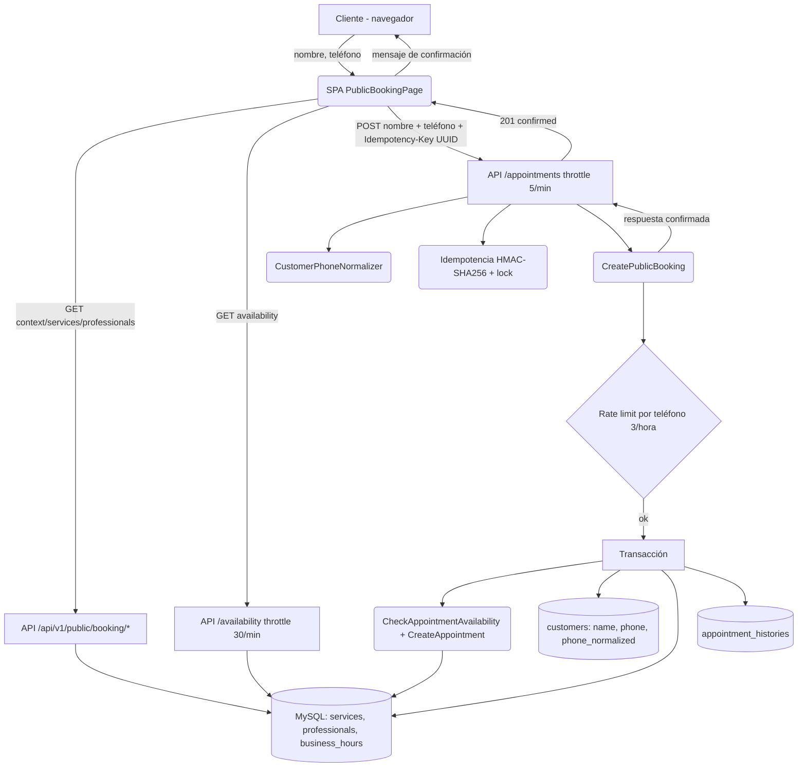
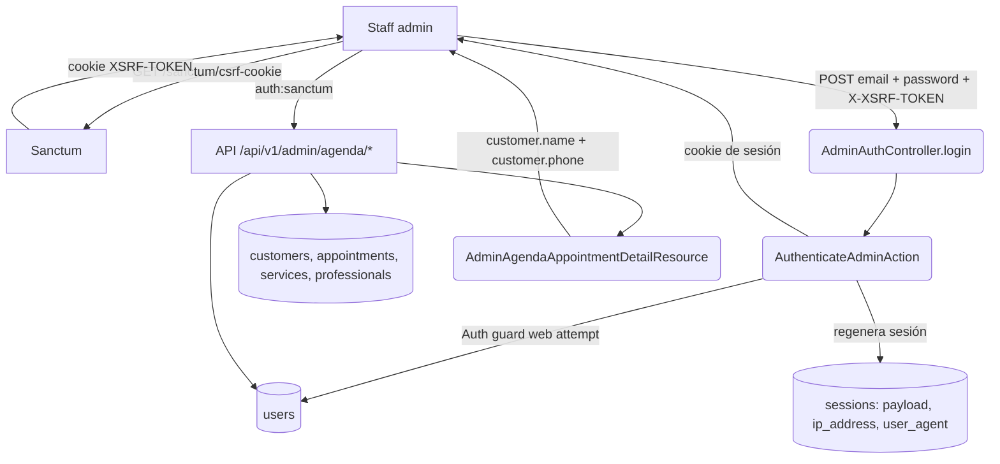
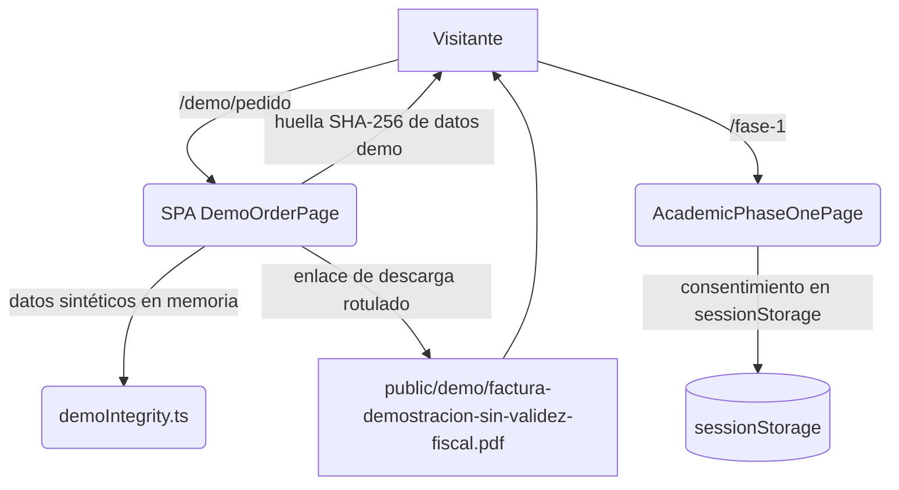

# FASE 2 — Diagrama de Flujo de Datos (DFD)

## Portada

| Campo | Valor |
|---|---|
| Proyecto | AgendaEstetica — Salón y Barbería Yaris |
| Fase | Fase 2 — Confianza del consumidor |
| Documento padre | [`FASE2_REPORTE_CONFIANZA_CONSUMIDOR.md`](./FASE2_REPORTE_CONFIANZA_CONSUMIDOR.md) |
| Matriz relacionada | [`FASE2_MATRIZ_RIESGOS.md`](./FASE2_MATRIZ_RIESGOS.md) |
| Commit inspeccionado | `34c274fdcf294e2386922f9856f42c9044e8176a` |
| Fecha | 2026-10-20 |
| Naturaleza | Auditoría documental. **No implementa cambios.** |

## 1. Explicación de los flujos principales

El sistema tiene tres flujos de datos relevantes para la confianza del consumidor:

1. **Reserva pública de cita:** el cliente introduce nombre y teléfono; el backend
   normaliza, valida, revalida disponibilidad y persiste al cliente y la cita.
2. **Acceso administrativo:** el personal inicia sesión (Sanctum/SPA) y consulta
   o modifica la agenda, incluyendo datos de clientes.
3. **Demostraciones académicas:** pedido/factura y Fase 1 no persisten datos reales
   ni se comunican con el backend.

## 2. Leyenda

- `[Actor]` usuario o sistema externo.
- `(Proceso)` lógica en backend o frontend.
- `[Almacén]` base de datos o almacenamiento del navegador.
- `--->` flujo de datos.
- `{R-…}` riesgo asociado de la matriz.

## 3. Diagrama — Reserva pública



**Datos personales:** nombre y teléfono (entrada), almacenados en `customers`
(texto plano — **{R-001}**).
**Controles existentes:** validación por Form Request, normalización, idempotencia,
rate limiting por IP y por teléfono, transacción.
**Riesgos:** {R-001}, {R-004}, {R-008}, {R-013}.

## 4. Diagrama — Acceso administrativo



**Datos personales expuestos al staff:** nombre y teléfono del cliente en el
detalle de cita (`AdminAgendaAppointmentDetailResource.php:29-33`).
**Controles existentes:** CSRF, `auth:sanctum`, regeneración de sesión, rate
limiting de login.
**Riesgos:** {R-002}, {R-003}, {R-004}, {R-009}.

**Datos personales expuestos al staff:** nombre y teléfono del cliente en el
detalle de cita (`AdminAgendaAppointmentDetailResource.php:29-33`).
**Controles existentes:** CSRF, `auth:sanctum`, regeneración de sesión, rate
limiting de login.
**Riesgos:** {R-002}, {R-003}, {R-004}, {R-009}.

## 5. Diagrama — Administración de profesionales, horarios y negocio

### 5.1 CRUD de profesionales

```mermaid
flowchart TD
    A[Staff admin] -->|GET /admin/profesionales| UI1[AdminProfessionalsPage]
    UI1 -->|GET /api/v1/admin/professionals| API1[AdminProfessionalController@index]
    API1 --> DB1[(professionals, professional_service, services)]
    UI1 -->|POST /api/v1/admin/professionals {name, service_ids[]}| API2[AdminProfessionalController@store]
    API2 --> VAL1[AdminProfessionalRequest: Rule::exists services]
    VAL1 --> DB1
    UI1 -->|PUT /api/v1/admin/professionals/{id} {name, service_ids[]}| API3[AdminProfessionalController@update]
    API3 --> VAL1
    VAL1 --> DB1
    UI1 -->|PATCH /api/v1/admin/professionals/{id}/status {active}| API4[AdminProfessionalController@status]
    API4 --> DB1
    UI1 -->|DELETE /api/v1/admin/professionals/{id}| API5[AdminProfessionalController@destroy]
    API5 --> CHK1{appointments().exists()}
    CHK1 -->|sí| ERR1[409 professional_has_appointments]
    CHK1 -->|no| DB1
```

**Controles existentes:** `AdminProfessionalRequest` (validación `service_ids` con `Rule::exists`), `auth:sanctum,admin`, CSRF, transacción en store/update, comprobación 409 en destroy.  
**Riesgos:** {R-016}, {R-017}.

### 5.2 Horarios de profesionales

```mermaid
flowchart TD
    A[Staff admin] -->|GET /admin/profesionales/:id/horarios| UI2[AdminProfessionalSchedulesPage]
    UI2 -->|GET /api/v1/admin/professionals/{id}/schedules| API6[AdminProfessionalScheduleController@index]
    API6 --> DB2[(professional_schedules)]
    UI2 -->|PUT /api/v1/admin/professionals/{id}/schedules {intervals[]}| API7[AdminProfessionalScheduleController@update]
    API7 --> VAL2[ProfessionalScheduleValidator]
    VAL2 -->|estructura, 1-7, H:i, inicio<fin, no solapamiento| DB2
    API7 --> TX[Transacción lockForUpdate]
    TX --> DB2
```

**Controles existentes:** `ProfessionalScheduleValidator` (estructura, semana 1–7, formato H:i, inicio<fin, no solapamiento mismo día), `ReplaceProfessionalSchedule` (transacción + `lockForUpdate`), `auth:sanctum,admin`, CSRF, confirmación UI con aviso de impacto.  
**Riesgos:** {R-018}, {R-019}.

### 5.3 Configuración del negocio

```mermaid
flowchart TD
    A[Staff admin] -->|GET /admin/negocio| UI3[AdminBusinessProfilePage]
    UI3 -->|GET /api/v1/admin/business/profile| API8[AdminBusinessProfileController@show]
    API8 --> DB3[(business_profile, business_hours)]
    UI3 -->|PUT /api/v1/admin/business/profile {name, phone, timezone, max_simultaneous_clients, hours[]}| API9[AdminBusinessProfileController@update]
    API9 --> VAL3[AdminBusinessProfileRequest + IanaTimezoneValidator]
    VAL3 -->|timezone IANA válido, hours[] estructura| DB3
    API9 --> ACT1[ReplaceBusinessHours]
    ACT1 --> DB3
```

**Controles existentes:** `AdminBusinessProfileRequest` (timezone con `timezone` rule de Laravel / `IanaTimezoneValidator`), `ReplaceBusinessHours` (transacción), `auth:sanctum,admin`, CSRF, singleton `singleton_key=1`.  
**Riesgos:** {R-020}.

---

## 6. Diagrama — Demostraciones académicas



**Datos personales:** ninguno real; valores sintéticos.
**Controles existentes:** rotulación explícita de demostración y "sin validez
fiscal"; sin persistencia en backend.
**Riesgos:** {R-007}, {R-012}, {R-014}.

## 6. Identificación de elementos

### 6.1 Datos personales

| Dato | Punto de entrada | Persistencia | Sensibilidad |
|---|---|---|---|
| Nombre | Formulario de reserva | `customers.name` (texto plano) | PII |
| Teléfono | Formulario de reserva | `customers.phone`, `phone_normalized` | PII |
| Credenciales admin | Login admin | `users` (hash) | Secreto |
| Sesión admin | Login admin | `sessions` (payload, ip, UA) | Sensible |
| Consentimiento académico | Banner / Fase 1 | `sessionStorage` | Bajo |

### 6.2 Puntos de entrada

- `POST /api/v1/public/booking/appointments` (datos de cliente).
- `POST /api/v1/admin/auth/login` (credenciales).
- `GET/PUT /api/v1/admin/business/profile` (perfil y horarios negocio).
- `GET/POST/PUT/PATCH/DELETE /api/v1/admin/professionals` (CRUD profesionales).
- `GET/PUT /api/v1/admin/professionals/{id}/schedules` (horarios profesionales).
- Resto de endpoints públicos (solo lectura de catálogo/disponibilidad).

### 6.3 Validaciones

- `PublicBookingAppointmentRequest`: tipos, patrón ISO-8601, UUID, normalización
  de teléfono.
- `AdminLoginRequest`: email válido y normalizado, contraseña requerida.
- `AdminProfessionalRequest`: nombre obligatorio, `service_ids[]` con `Rule::exists('services','id')`.
- `AdminProfessionalScheduleRequest`: `intervals[]` con estructura, semana 1–7, H:i, inicio<fin.
- `AdminBusinessProfileRequest`: timezone IANA válido (`timezone` rule / `IanaTimezoneValidator`), hours[] estructura.
- Revalidación de negocio en `CreatePublicBooking` dentro de transacción.
- `ProfessionalScheduleValidator`: estructura, semana 1–7, H:i, inicio<fin, no solapamiento mismo día.
- `ReplaceProfessionalSchedule` / `ReplaceBusinessHours`: transacción + `lockForUpdate`.

### 6.4 Servicios / procesos

- `CreatePublicBooking`, `CheckAppointmentAvailability`, `CreateAppointment`,
  `ListPublicBookableTimes`, `AuthenticateAdminAction`.
- `ReplaceProfessionalSchedule`, `ReplaceBusinessHours`,
  `ProfessionalScheduleValidator`, `IanaTimezoneValidator`.

### 6.5 Persistencia

- MySQL: `customers`, `appointments`, `appointment_histories`, `services`,
  `professionals`, `business_hours`, `business_profile`, `professional_schedules`,
  `professional_service`, `professional_time_off`, `users`, `sessions`.

### 6.6 Respuestas al usuario

- Confirmación de cita (`201`), conflictos `409` (`idempotency_key_conflict`,
  `appointment_unavailable`), validación `422`, throttle `429`
  (`too_many_requests`), error `500` neutro.

## 8. Fronteras de confianza y validación adicional

| Frontera | Cruce | Control actual | Requiere validación adicional |
|---|---|---|---|
| Navegador ↔ API | Datos de reserva | HTTPS (no verificado), validación backend | HTTPS/HSTS ({R-015}) |
| Navegador ↔ sesión | Cookie de sesión | CSRF, httpOnly, sameSite lax | Flag `Secure` ({R-003}) |
| API ↔ Datos de cliente | Escritura/lectura PII | Transacción, validación | Cifrado/minimización ({R-001}) |
| Staff ↔ datos de clientes | Lectura PII | `auth:sanctum` | Política de acceso/retención ({R-005}) |
| Repositorio ↔ producción | Configuración | Ninguno en repo | `APP_DEBUG`, cookies ({R-002}, {R-003}) |
| Admin ↔ Profesionales | CRUD + servicios | `auth:sanctum,admin`, Form Request, transacción | Verificar 409 en destroy ({R-016}, {R-017}) |
| Admin ↔ Horarios | CRUD horarios | `ProfessionalScheduleValidator`, transacción `lockForUpdate` | Verificar no solapamiento ({R-018}, {R-019}) |
| Admin ↔ Negocio | Perfil + horarios | `IanaTimezoneValidator`, `ReplaceBusinessHours` | Verificar timezone IANA ({R-020}) |

## 9. Supuestos y pendientes

- **Supuesto:** el transporte en producción emplea HTTPS; **no verificable** desde
  el repositorio (marcado como pendiente, {R-015}).
- **Pendiente:** valor real de `APP_DEBUG` y `SESSION_SECURE_COOKIE` en
  producción; no verificable desde el repositorio.
- **Pendiente:** actualización de `symfony/http-foundation` a v7.4.19+ para
  corregir `CVE-2026-108082` ({R-023}); requiere validación compatibilidad Laravel 13.
- **No evaluado:** el commit inspeccionado no contiene el trabajo XML/CFDI de
  SPEC-024 Checkpoint D; no se diagrama.
- Los diagramas reflejan la arquitectura **verificada en el commit**; cualquier
  detalle no comprobado se ha marcado como supuesto o pendiente.
