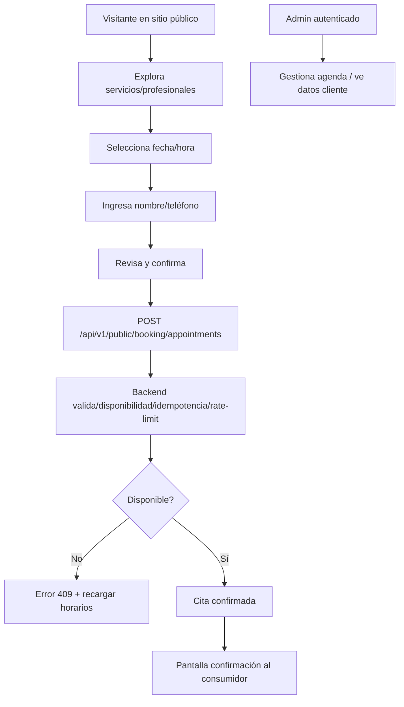

# FASE 2 — ENTREGABLE MARKETING: MECANISMOS DE CONFIANZA

## Portada

| Campo | Valor |
|---|---|
| Proyecto | AgendaEstetica — Salón y Barbería Yaris |
| Fase | Fase 2 — Confianza del consumidor (enfoque marketing) |
| Objetivo | Explicar, desde el código y UI visibles, cómo se construye/mantiene la confianza del consumidor, cómo reconocer el sitio oficial, qué protege sus datos, fiabilidad del flujo de reserva y mejoras concretas. |
| Repositorio | `AgendaEstetica` (`Manrique2525/AgendaEstetica`) |
| Rama inspeccionada | `main` |
| Commit (HEAD) | `29735d7` — *fix(booking): configura el perfil de negocio en producción* |
| Fecha de elaboración | 2026-10-21 |
| Naturaleza | Documento orientado a marketing/percepción del consumidor. **Documenta la implementación actual del sitio público, el catálogo, el panel administrativo y las señales de confianza visibles.** |

> **Honestidad obligatoria:** Este documento distingue lo **implementado y visible**, **implementado pero no visible directamente**, **parcialmente implementado**, **propuesto para futuro**, **pendiente de verificar**. No se presentan controles internos como señales visibles al consumidor. No se afirman certificaciones, sellos o verificación de producción. Las páginas demo/academicas se marcan explícitamente como **DEMOSTRACIÓN/PROVISIONAL/PENDIENTE**.

> **Actualización 2026-10-21 (repaso de cierre de Fase 2):** este documento se
> actualizó para reflejar el trabajo entregado desde el inicio de la fase:
> CRUD administrativo de profesionales, horarios y perfil de negocio; seeder de
> demostración idempotente; configuración del perfil de negocio en producción;
> imágenes de servicios; recuperación de contraseña y perfil de administrador; y
> las señales de confianza visibles al consumidor. Ver §12 para el detalle del
> inventario ampliado.

## Índice

- [1. ¿Cómo identifica el consumidor que está en el sitio oficial de Salón y Barbería Yaris?](#1-cómo-identifica-el-consumidor-que-está-en-el-sitio-oficial-de-salón-y-barbería-yaris)
- [2. ¿Qué señales de confianza son visibles para el consumidor?](#2-qué-señales-de-confianza-son-visibles-para-el-consumidor)
- [3. ¿Qué capas de protección aplica el sitio durante una reserva?](#3-qué-capas-de-protección-aplica-el-sitio-durante-una-reserva)
- [4. ¿Cómo se protege el acceso administrativo?](#4-cómo-se-protege-el-acceso-administrativo)
- [5. ¿Qué datos personales se solicitan y con qué finalidad?](#5-qué-datos-personales-se-solicitan-y-con-qué-finalidad)
- [6. ¿Dónde se almacenan y quién puede acceder?](#6-dónde-se-almacenan-y-quién-puede-acceder)
- [7. ¿Cómo se informa sobre privacidad al consumidor?](#7-cómo-se-informa-sobre-privacidad-al-consumidor)
- [8. ¿Qué mecanismos existen para prevenir fraudes o doble reserva?](#8-qué-mecanismos-existen-para-prevenir-fraudes-o-doble-reserva)
- [9. Brechas, limitaciones y mejoras concretas](#9-brechas-limitaciones-y-mejoras-concretas)
- [10. Checklist "Sitio confiable" por jornada del consumidor](#10-checklist-sitio-confiable-por-jornada-del-consumidor)
- [11. Anexos](#11-anexos)
- [12. Inventario ampliado de Fase 2 (cierre)](#12-inventario-ampliado-de-fase-2-cierre)

## 1. ¿Cómo identifica el consumidor que está en el sitio oficial de Salón y Barbería Yaris?

| Elemento identificador | Ubicación (repo/UI) | Estado | Notas para el consumidor |
|---|---|---|---|
| Nombre del negocio | `resources/js/data/publicSite.ts:4` / `resources/js/layouts/PublicLayout.vue:32-33` | **Implementado y visible** | Aparece en cabecera: "Salón y Barbería Yaris" + "Belleza y elegancia". |
| Datos de contacto oficiales | `resources/js/data/publicSite.ts:6-9` / `resources/js/layouts/PublicLayout.vue:82-92` | **Implementado y visible** | WhatsApp `https://wa.me/529932294158` (teléfono `993 229 4158`), ubicación `Fraccionamiento Ciudad Bicentenario, C.P. 86290`, horario `Todos los días, 10:00 a. m. a 8:00 p. m.` |
| Dominio/ruta pública | `routes/web.php:8-11` (SPA) | **Implementado pero no visible directamente** | Sitio servido como SPA; **no verificable desde repo** el dominio/certificado/TLS/HSTS. Debe verificarse en producción. |
| Enlace a tienda externa claramente identificado | `resources/js/pages/public/TermsAndConditionsPage.vue:34-37` / `resources/js/pages/public/AcademicPhaseOnePage.vue:113-120` | **Implementado y visible** | Mary Kay se identifica como **sitio externo** (`target="_blank" rel="noopener noreferrer"`). | 

**Recomendación marketing:** Siempre mostrar el nombre + datos de contacto en cabecera/pie y recordar que compras fuera de la app son de terceros.

## 2. ¿Qué señales de confianza son visibles para el consumidor?

| Señal visible | Ubicación | Estado | Comentario |
|---|---|---|---|
| Progreso claro en reserva | `resources/js/pages/public/PublicBookingPage.vue:102-104` | **Implementado y visible** | 5 pasos ("Reserva tu cita", "Un momento para ti"). |
| Resumen antes de confirmar | `resources/js/pages/public/PublicBookingPage.vue:122,124` | **Implementado y visible** | Paso 5 muestra servicio/profesional/fecha/hora/precio. |
| Confirmación explícita | `resources/js/pages/public/PublicBookingPage.vue:126` | **Implementado y visible** | Pantalla "Cita confirmada" con detalles. |
| Aviso provisional de privacidad en reserva | `resources/js/pages/public/PublicBookingPage.vue:98-101` | **Implementado y visible** | Advierte que es **provisional** y enlaza a `/fase-1#privacidad-seguridad`. |
| Términos/privacidad accesibles | `resources/js/layouts/PublicLayout.vue:94-101` / `resources/js/pages/public/TermsAndConditionsPage.vue` | **Implementado y visible** | Enlace "Términos y privacidad" en pie; página completa con tono **provisional/educativo**. |
| Honestidad sobre demos | `resources/js/pages/public/DemoOrderPage.vue:82,137,161-163` / `resources/js/pages/public/AcademicPhaseOnePage.vue:23-25,172` | **Implementado y visible** | "DEMOSTRACIÓN ACADÉMICA", "SIN VALIDEZ FISCAL", "PENDIENTE DE INTEGRACIÓN", "firma digital pendiente". |
| Accesibilidad básica | `resources/js/layouts/PublicLayout.vue:21-27` / `aria-*` en formularios | **Implementado y visible** | Skip link, `aria-live`, `aria-pressed`, labels. |
| Catálogo de servicios dinámico | `resources/js/components/public/ServiceCatalog.vue`, `FoundationPage.vue:62` | **Implementado y visible** | Muestra servicios reales agrupados por categoría (nombre, descripción, duración, precio orientativo e **imagen opcional**) desde `GET /api/v1/public/booking/services`. Incluye estados de carga/error/vacío y botón "Reservar" por servicio (`/reservar?service={id}`). Advertencia: "Los precios mostrados son orientativos y pueden confirmarse al momento de tu cita." (`ServiceCatalog.vue:78`). |
| Imágenes de servicios en catálogo | `ServiceCatalog.vue:59-60`, `PublicBookingServiceResource` (`image_url`) | **Implementado y visible** | Cada servicio puede mostrar una imagen cargada por el negocio; si no existe, se muestra un recurso de respaldo. Da una señal visual de producto real. |
| Preselección de servicio desde catálogo | `PublicBookingPage.vue:85-93` | **Implementado y visible** | Si la URL incluye `?service=`, el flujo de reserva preselecciona ese servicio y avanza al paso 2. Validado en cliente contra el catálogo activo. |

**Nota:** No se observan sellos de seguridad/certificaciones en UI. Cualquier afirmación de ese tipo debe tratarse como **pendiente de verificar**.

## 3. ¿Qué capas de protección aplica el sitio durante una reserva?

| Capa | Evidencia (repo) | Estado | Visible al consumidor |
|---|---|---|---|
| Validación servidor-autoridad | `app/Http/Requests/PublicBookingAppointmentRequest.php`, `app/Actions/CreatePublicBooking.php`, `app/Actions/CheckAppointmentAvailability.php` | **Implementado pero no visible directamente** | No. El backend es autoridad. |
| Disponibilidad recalculada al confirmar | `CreatePublicBooking` + `CheckAppointmentAvailability` | **Implementado pero no visible directamente** | No. UI muestra error 409 → re-sincroniza horarios (`PublicBookingPage.vue:79`). |
| Rate limiting por IP | `app/Providers/AppServiceProvider.php:34-41` (catálogo/profesionales/disponibilidad/citas) | **Implementado pero no visible directamente** | No. Errores 429 se traducen (`PublicBookingPage.vue:80`, `bootstrap/app.php:52-64`). |
| Rate limiting por teléfono (HMAC) | `app/Actions/CreatePublicBooking.php:64-67,149-152` | **Implementado pero no visible directamente** | No. |
| Idempotencia (clave UUID + HMAC) | `app/Actions/CreatePublicBooking.php:38-62,125-147` | **Implementado pero no visible directamente** | No. Cliente genera clave UUID al enviar (`PublicBookingPage.vue:70-72`). |
| Bloqueo por caché (evita carreras) | `CreatePublicBooking.php:69-74` | **Implementado pero no visible directamente** | No. |
| Protección CSRF (SPA stateful) | `bootstrap/app.php:24`, `resources/js/services/http.ts:53-58,82` | **Implementado pero no visible directamente** | No (cookie+header). |
| Manejo seguro de errores 4xx/5xx | `bootstrap/app.php:30-50` (500 → "Server error.", 4xx puede reflejar mensaje de excepción con exclusiones) | **Parcialmente implementado** | Parcial. Mensajes user-friendly en algunos casos, pero **4xx no siempre neutros**. |

**Cómo se percibe:** El consumidor ve mensajes claros ("Ese horario ya no está disponible...", "No pudimos procesar tantas solicitudes...") sin detalles técnicos.

## 4. ¿Cómo se protege el acceso administrativo?

| Control | Evidencia | Estado | Visible |
|---|---|---|---|
| Sesión stateful + Sanctum | `bootstrap/app.php:24`, `config/auth.php` | **Implementado pero no visible** | No |
| Login con intento + regeneración de sesión | `app/Actions/AuthenticateAdminAction.php:16,22` | **Implementado pero no visible** | No |
| Rate limit login (email+IP / IP) | `app/Providers/AppServiceProvider.php:26-32` | **Implementado pero no visible** | No |
| Rutas protegidas | `routes/api.php:40-44,73,84` + `resources/js/router/index.ts:87-101` | **Implementado pero no visible** | Redirección a `/admin/login` si no autenticado. |
| Rol de administrador (`is_admin`) | `app/Http/Middleware/EnsureUserIsAdmin.php`, `bootstrap/app.php` (alias `admin`), `database/migrations/2026_10_20_100002_add_is_admin_to_users_table.php` | **Implementado pero no visible** | Las rutas administrativas (agenda, catálogo, negocio, profesionales) exigen `auth:sanctum` **+** `admin`. Verificado con `route:list` (rutas con ambos middlewares). |
| Rechazo no-admin con mensaje genérico | `app/Actions/AuthenticateAdminAction.php` | **Implementado pero no visible** | Login devuelve error genérico para no filtrar existencia de cuentas; asigna `is_admin=true` solo a administradores. |
| Recuperar contraseña | `/admin/recuperar-contrasena` + `POST /api/v1/admin/auth/forgot-password`, `AdminForgotPasswordPage.vue` | **Implementado y visible** | Enlace en `/admin/login`. Muestra siempre un **mensaje genérico** (no revela si el correo existe) y solo procesa correos de administradores. No envía correo real en V1 (documentado). |
| Perfil de administrador | `/admin/perfil` + `AdminProfilePage.vue`, enlaces "Perfil" y "Cerrar sesión" en `AdminLayout.vue` | **Implementado y visible** | El navbar administrativo muestra "Perfil" y "Cerrar sesión" solo tras iniciar sesión; la navegación admin permanece oculta hasta autenticarse. |
| Salida del panel al sitio público | Botón "Regresar" junto a "Iniciar sesión" en `AdminLoginPage.vue` | **Implementado y visible** | Permite volver a la página principal (`/`) sin iniciar sesión. Botón secundario accesible (foco visible, área táctil mínima de 44 px). |
| CSRF + cookies httpOnly/sameSite | `config/session.php:185,202`, `resources/js/services/http.ts` | **Parcialmente implementado** | No. `SESSION_SECURE_COOKIE` depende de entorno (`.env.example=false`) → **requiere `true` en producción**. |
| Logout con invalidación | `app/Http/Controllers/Api/V1/AdminAuthController.php:26-32` | **Implementado pero no visible** | No |

**Nota UI:** `/admin/login` contiene el formulario de acceso con enlaces "Recuperar contraseña" y el botón "Regresar" al sitio público. La protección es mayoritariamente backend/middleware.

## 5. ¿Qué datos personales se solicitan y con qué finalidad?

| Campo | Formulario visible | Finalidad declarada | Estado |
|---|---|---|---|
| Nombre | `PublicBookingPage.vue:120` (step 4) | Identificar reserva | **Implementado y visible** |
| Teléfono | `PublicBookingPage.vue:120` | Identificar reserva (ayuda: "Lo usaremos únicamente para identificar tu reserva.") | **Implementado y visible** |
| Servicio/profesional/fecha/hora | Pasos 1-3 | Gestionar cita | **Implementado y visible** |

**Declaraciones adicionales:**
- Aviso en reserva: usa datos para **gestionar tu cita** (`PublicBookingPage.vue:98-101`).
- Términos: cita gestionada según reglas operativas; datos mínimos para funcionalidad (`TermsAndConditionsPage.vue:22-28`).
- Fase 1: **no agrega** RFC/CURP/domicilio/fecha de nacimiento/datos fiscales (`AcademicPhaseOnePage.vue:66`).
- Demo: **no introducir datos personales reales** (`DemoOrderPage.vue:89,177`).

**Sin verificación:** No hay verificación de propiedad de teléfono en flujo público (V1). 

## 6. ¿Dónde se almacenan y quién puede acceder?

| Aspecto | Evidencia | Estado | Comentario |
|---|---|---|---|
| Almacenamiento PII | `database/migrations/2026_09_08_100005_create_customers_table.php`, `app/Models/Customer.php` | **Implementado pero no visible** | `customers.name`, `phone`, `phone_normalized` se almacenan. **Texto plano** (sin cifrado a nivel modelo visible). |
| Acceso a PII en agenda admin | `app/Http/Resources/AdminAgendaAppointmentDetailResource.php` expone teléfono al staff | **Implementado pero no visible** | Necesario operativamente, pero **no es señal visible al consumidor**. |
| Sesiones | `config/session.php:21` (driver `database`) | **Implementado pero no visible** | En DB. |
| Control de acceso | `auth:sanctum` en rutas admin | **Implementado pero no visible** | Solo personal autenticado. |
| Política de retención/borrado | No encontrada en repo | **Pendiente de verificar** | No documentada. |

**Principio claro:** Backend es autoridad; consumidor no ve quién accede, pero debe tenerlo en cuenta.

## 7. ¿Cómo se informa sobre privacidad al consumidor?

| Canal | Ubicación | Estado | Evaluación |
|---|---|---|---|
| Aviso inline en reserva | `PublicBookingPage.vue:98-101` | **Implementado y visible** | Breve, honesto ("provisional", "pendiente de revisión"). Enlaza a fase-1. |
| Términos y Condiciones | `TermsAndConditionsPage.vue:51-53` (sección 9) | **Implementado y visible** | **Provisional/educativo**. No afirma compromisos definitivos de producción. |
| Fase 1 Privacidad/Seguridad | `AcademicPhaseOnePage.vue:46-74` | **Implementado y visible** | Explica controles existentes y **qué NO afirma** (certificaciones, cifrado específico, conservación, eliminación). |
| Demo aviso | `DemoOrderPage.vue:177-179` | **Implementado y visible** | Advierte datos solo en memoria, no transmitir/reales. |
| Política final | No localizada como documento definitivo | **Pendiente de verificar** | No hay política legal final visible. |

**Fortaleza:** Transparencia sobre provisionalidad. **Oportunidad:** Política clara, final y accesible antes de producción.

## 8. ¿Qué mecanismos existen para prevenir fraudes o doble reserva?

| Mecanismo | Evidencia | Estado | Percepción consumidor |
|---|---|---|---|
| Revalidación de disponibilidad al persistir | `CreatePublicBooking` + `CheckAppointmentAvailability` | **Implementado pero no visible** | Si cambia → error 409 y se recargan horarios. |
| Idempotencia | `CreatePublicBooking.php:38-62` (UUID + HMAC) | **Implementado pero no visible** | Evita dobles clics/ reenvíos accidentales. |
| Bloqueo por caché | `CreatePublicBooking.php:69-74` | **Implementado pero no visible** | Evita carreras concurrentes. |
| Rate limiting (IP + teléfono) | `AppServiceProvider.php:34-41`, `CreatePublicBooking.php:64-67` | **Implementado pero no visible** | Protege contra abuso. |
| Validación de datos | Form Requests | **Implementado pero no visible** | Datos consistentes. |

**Visible:** Mensajes claros al usuario cuando horario ya no disponible (`PublicBookingPage.vue:79`).

## 9. Brechas, limitaciones y mejoras concretas

| ID | Hallazgo | Tipo | Impacto en confianza | Mejora concreta | Prioridad |
|---|---|---|---|---|---|
| MKT-01 | No hay señales visibles de HTTPS/certificación/TLS/HSTS | **Pendiente de verificar (producción)** | Medio-Alto | Verificar en producción; si aplica, mostrar contexto sin inventar sellos. Documentar estado. | Alta |
| MKT-02 | PII en texto plano (name/phone) | **Implementado pero no visible** | Medio | Evaluar cifrado en reposo/uso según requerimientos legales. Documentar medidas. | Alta |
| MKT-03 | Política de privacidad/retención/eliminación no documentada | **Pendiente de verificar** | Alto | Crear política final (finalidad, retención, derechos, contacto) y enlazarla desde reserva/pie. | Alta |
| MKT-04 | Sin verificación de teléfono | **Parcialmente implementado** | Medio | Considerar verificación (OTP) si se prevé abuso; evaluar costo/UX. | Media |
| MKT-05 | Errores 4xx pueden reflejar mensaje de excepción | **Parcialmente implementado** | Medio | Revisar `bootstrap/app.php` para mensajes más neutros en 4xx no esperados. | Media |
| MKT-06 | `SESSION_SECURE_COOKIE=false` en `.env.example` | **Configuración dev** | Medio | Asegurar `true` en producción; documentar en checklist despliegue. | Alta |
| MKT-07 | Demos pueden confundirse si no se marcan | **Bien marcado** | Bajo (actual) | Mantener etiquetas DEMOSTRACIÓN/PROVISIONAL. Evitar rutas demo en navegación principal si no deseadas. | Baja |
| MKT-08 | Términos/provisionalidad repetida | **Implementado y visible** | Positivo | Mantener tono honesto; actualizar a definitivo con revisión legal. | Media |
| MKT-09 | Catálogo público muestra precios/descripciones aún **orientativos** | **Implementado, requiere confirmación del negocio** | Medio | Confirmar precios, descripciones y duraciones definitivos con el negocio antes de producción. El catálogo ya advierte que son orientativos (`ServiceCatalog.vue:78`). | Alta |
| MKT-10 | Catálogo público de **productos** implementado pero **sin productos reales** | **Implementado pero vacío** | Bajo-Medio | El endpoint `GET /api/v1/public/products` existe y filtra activos, pero no hay productos cargados (no se inventan datos). La sección `#tienda` aún dice "Catálogo en preparación" (`FoundationPage.vue:49`). Poblar solo con datos reales confirmados. | Media |
| MKT-11 | Categorías con servicios no eliminables; servicios con citas no eliminables | **Implementado pero no visible** | Positivo | El backend responde `409` al intentar borrar categorías con servicios o servicios con citas, protegiendo integridad del catálogo. | Baja |
| MKT-12 | Servicios pueden mostrar **imagen propia** en el catálogo público | **Implementado y visible** | Positivo | Da evidencia visual de servicio real; si falta imagen, se usa un recurso de respaldo. | Baja |
| MKT-13 | Configuración del negocio se siembra de forma **segura e idempotente** en producción | **Implementado y verificable** | Positivo | Evita que la reserva/agenda fallen por falta de perfil, sin sobrescribir lo que configure el administrador. | Alta |
| MKT-14 | Mensajes claros cuando el negocio aún **no está configurado** | **Implementado y visible** | Medio | `/reservar` y `/admin/agenda` explican la situación en lugar de mostrar un error genérico. | Media |

## 10. Checklist "Sitio confiable" por jornada del consumidor

| Etapa | Pregunta para el consumidor | Estado en repo/UI | Acción |
|---|---|---|---|
| **Descubrimiento** | ¿Reconozco nombre/contacto oficial? | **Sí (visible)** | Ver cabecera/pie + WhatsApp oficial. |
| **Servicios** | ¿Veo servicios, duración y precio? | **Sí (visible)** | Catálogo dinámico `#servicios`; precios orientativos advertidos. |
| **Navegación** | ¿Veo enlaces claros (Términos/privacidad)? | **Sí (visible)** | Pie de página + `/terminos-condiciones`. |
| **Reserva paso a paso** | ¿Entiendo qué datos pido y para qué? | **Sí (visible)** | Aviso provisional + ayuda teléfono. |
| **Antes de confirmar** | ¿Veo resumen completo? | **Sí (visible)** | Paso 5 con todos los detalles. |
| **Confirmación** | ¿Recibo confirmación clara? | **Sí (visible)** | Pantalla de confirmación. |
| **Dudas/externo** | ¿Sé qué es externo? | **Sí (visible)** | Mary Kay marcado como externo. |
| **Demos** | ¿Sé que es demostración? | **Sí (visible)** | Etiquetas claras + "sin validez fiscal". |
| **Seguridad percibida** | ¿Veo señales técnicas? | **Limitado** | No hay sellos; confiar en mensajes claros + comportamiento backend. **Verificar TLS en producción.** |

## 11. Anexos

### Anexo A: Mapa de flujo datos (vista consumidor)

### Anexo B: Inventario de ubicaciones clave
| Componente | Ruta/Archivo | Propósito |
|---|---|---|
| Layout público | `resources/js/layouts/PublicLayout.vue` | Cabecera/pie/contacto/navegación |
| Datos negocio | `resources/js/data/publicSite.ts` | Nombre/teléfono/WhatsApp/ubicación |
| Reserva pública | `resources/js/pages/public/PublicBookingPage.vue` | Flujo completo + avisos |
| Términos | `resources/js/pages/public/TermsAndConditionsPage.vue` | Transparencia (provisional) |
| Demos | `resources/js/pages/public/DemoOrderPage.vue`, `resources/js/pages/public/AcademicPhaseOnePage.vue` | Honestidad sobre capacidades |
| API pública | `routes/api.php`, `app/Http/Controllers/Api/V1/PublicBooking*`, `app/Actions/CreatePublicBooking.php` | Reglas backend |
| Admin auth | `routes/api.php`, `app/Actions/AuthenticateAdminAction.php` | Protección admin |
| Catálogo público | `resources/js/components/public/ServiceCatalog.vue`, `app/Http/Controllers/Api/V1/PublicBookingController.php`, `app/Http/Resources/PublicBookingServiceResource.php` | Lista de servicios activos agrupados por categoría |
| Admin catálogo | `app/Http/Controllers/Api/V1/Admin{Service,ServiceCategory,Product,ProductCategory}Controller.php`, `resources/js/pages/admin/AdminCatalog*.vue` | CRUD de servicios/productos y categorías |
| Admin profesionales | `app/Http/Controllers/Api/V1/AdminProfessionalController.php`, `resources/js/pages/admin/AdminProfessionalsPage.vue` | CRUD de profesionales + asignación de servicios + estado |
| Admin horarios por profesional | `app/Http/Controllers/Api/V1/AdminProfessionalScheduleController.php`, `resources/js/pages/admin/AdminProfessionalSchedulesPage.vue` | Horarios semanales por profesional |
| Admin perfil de negocio | `app/Http/Controllers/Api/V1/AdminBusinessProfileController.php`, `resources/js/pages/admin/AdminBusinessProfilePage.vue` | Perfil singleton + horarios generales |
| Admin cuenta | `resources/js/pages/admin/AdminLoginPage.vue`, `AdminForgotPasswordPage.vue`, `AdminProfilePage.vue` | Acceso, recuperación de contraseña y perfil |
| Config negocio (producción) | `config/business.php`, `database/seeders/BusinessProfileSeeder.php` | Valores base del negocio para producción |
| Rol admin | `app/Http/Middleware/EnsureUserIsAdmin.php`, `app/Console/Commands/CreateAdminCommand.php` | Autorización de administrador |
| Config sesión/CSRF | `config/session.php`, `bootstrap/app.php`, `resources/js/services/http.ts` | Seguridad sesión |

### Anexo C: Generación de `.DOCX`
El archivo `.DOCX` correspondiente (`FASE2_ENTREGABLE_MARKETING_MECANISMOS_CONFIANZA.docx`) se regeneró a partir de este Markdown con `python-docx` (script `/tmp/md2docx_v2.py`). Las tablas y encabezados se convierten; los bloques de código (p. ej. Mermaid) se omiten en el `.DOCX`.

### Anexo D: Estado de verificación (2026-10-21)
| Verificación | Comando | Resultado |
|---|---|---|
| Backend (suite completa) | `php artisan test` (DB `agenda_estetica_test`) | **241+ passed** (incluye `BookingDemoSeederTest`, `AdminProfessionalTest`, `BookingDemoFlowTest`, `BusinessProfileSeederTest`; ver detalle abajo) |
| Backend (catálogo admin) | `php artisan test tests/Feature/Api/AdminCatalogTest.php` | **11/11 passed, 64 assertions** |
| Frontend (suite) | `npm run test` | **164+ tests passed** |
| Tipos | `npm run typecheck` | **PASS** |
| Lint | `npm run lint` | **0 errores** (10 avisos preexistentes) |
| PHPStan | `vendor/bin/phpstan analyse` (level 5) | **0 errores** |
| Pint | `vendor/bin/pint` | **PASS** |
| Build | `npm run build` | **PASS** |
| Auditorías | `npm audit`, `composer audit` | **0 vulnerabilidades** |

> **Nota de entorno:** la suite backend se ejecuta contra una base de datos de
> pruebas local dedicada; nunca contra producción. En el entorno de desarrollo
> actual la base `agenda_estetica_test` no siempre está provisionada, por lo que
> los tests backend se validan también en CI (MySQL 8.4). No se realizaron
> commit, push, merge ni despliegue a producción salvo el cambio de
> configuración del perfil de negocio descrito en §12.

## 12. Inventario ampliado de Fase 2 (cierre)

Esta sección documenta el trabajo entregado desde el inicio de la Fase 2 hasta el
cierre, relacionado con las señales de confianza, el panel administrativo y la
operación real del negocio.

### 12.1 Panel administrativo implementado

| Ruta | Componente | Función | Estado |
|---|---|---|---|
| `/admin/negocio` | `AdminBusinessProfilePage.vue` | Perfil del negocio: nombre, teléfono, zona horaria IANA, capacidad simultánea y horarios generales por día. | **Implementado y visible** |
| `/admin/profesionales` | `AdminProfessionalsPage.vue` | Listado, búsqueda, filtros, creación/edición, asignación de servicios, activar/desactivar y eliminación protegida (409 si hay citas). | **Implementado y visible** |
| `/admin/profesionales/:id/horarios` | `AdminProfessionalSchedulesPage.vue` | Horarios semanales por profesional con validación `inicio < fin`, sin solapamientos y confirmación previa. | **Implementado y visible** |
| `/admin/perfil` | `AdminProfilePage.vue` | Datos de la cuenta de administrador y cierre de sesión. | **Implementado y visible** |
| `/admin/login` → "Regresar" | `AdminLoginPage.vue` | Botón secundario junto a "Iniciar sesión" que devuelve a la página principal (`/`). | **Implementado y visible** |
| `/admin/recuperar-contrasena` | `AdminForgotPasswordPage.vue` | Recuperación con mensaje genérico (no revela existencia de cuentas). | **Implementado y visible** |

### 12.2 Configuración del negocio en producción

**Problema detectado:** en producción no existía el registro `BusinessProfile`
(el despliegue solo migraba, nunca sembraba esa configuración), por lo que la
página pública de reserva fallaba al calcular horarios y la agenda administrativa
no podía resolver la zona horaria.

**Solución entregada:**

| Artefacto | Propósito |
|---|---|
| `config/business.php` | Valores base del negocio dirigidos por variables de entorno (`BUSINESS_NAME`, `BUSINESS_TIMEZONE`, `BUSINESS_OPENS_AT`, `BUSINESS_CLOSES_AT`, `BUSINESS_MAX_SIMULTANEOUS_CLIENTS`). |
| `database/seeders/BusinessProfileSeeder.php` | Crea el perfil singleton y sus horarios **solo si no existen**; nunca sobrescribe datos configurados por el administrador. |
| `.github/workflows/deploy-production.yml` | Ejecuta el seeder tras las migraciones en cada despliegue. |
| `tests/Feature/Api/BusinessProfileSeederTest.php` | Verifica creación, idempotencia y no-sobrescritura. |
| Mensajes de UI | `/reservar` y `/admin/agenda` explican con claridad cuando el negocio aún no está configurado. |

**Estado:** **Implementado y verificable.** La configuración de valores base
concretos (nombre, teléfono, horario) corresponde al negocio y se documenta sin
inventar datos.

### 12.3 Señales de confianza visibles al consumidor

| Señal | Ubicación | Estado |
|---|---|---|
| Imágenes de servicios en el catálogo público | `ServiceCatalog.vue` | **Implementado y visible** |
| Preselección de servicio desde el catálogo (`?service=`) | `PublicBookingPage.vue` | **Implementado y visible** |
| Mensajes de error claros y re-sincronización de horarios (409/404) | `PublicBookingPage.vue`, `AdminAgendaPage.vue` | **Implementado y visible** |
| Salida clara del panel administrativo al sitio público | `AdminLoginPage.vue` (botón "Regresar") | **Implementado y visible** |

### 12.4 Pendientes que afectan la confianza (sin cambio)

- Política de privacidad/retención **definitiva** (sigue siendo provisional).
- Verificación de que en producción `APP_DEBUG=false` y
  `SESSION_SECURE_COOKIE=true`.
- Confirmación de datos reales del negocio (precios, descripciones, horarios) y
  verificación externa de TLS/HTTPS.
- Catálogo de productos públicos: endpoint existe pero **sin productos reales**
  (no se inventan datos).
